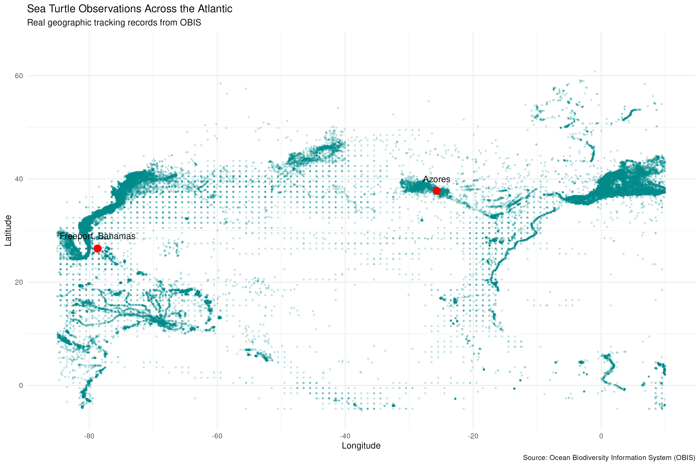

# Sailing from Freeport, Bahamas, to the Azores

## Following the Migration Patterns of Sea Turtles

This project explores sea turtle migration across the Atlantic Ocean using real tracking data.

Our journey follows a sailing route from Freeport, Bahamas, toward the Azores while exploring where sea turtles travel, how far they migrate, and how their paths connect across the ocean.

## Research Question

How do sea turtle migration patterns connect the Caribbean and the Atlantic Ocean?

## Sea Turtle Migration Across the Atlantic

The following map displays 120,718 sea turtle observations
from the Atlantic study region.

These observations help illustrate the geographic
distribution of sea turtles across the ocean.

The red markers identify Freeport, Bahamas, and the
Azores, Portugal. The sailing route is a proposed journey,
not a measured turtle migration path.
